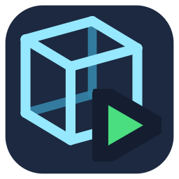

# MeshViewer

[](https://github.com/ERambler/MeshViewer/releases/latest)
[](https://github.com/ERambler/MeshViewer/actions/workflows/ci.yml)

**Быстрый просмотрщик 3D-моделей для Windows: GLB (glTF) и OBJ с текстурами.**
Один файл `MeshViewer.exe`, готов к работе за четверть секунды, без установки .NET.

## Возможности

- **GLB и OBJ (+MTL)**: текстуры png, jpeg и webp, материалы, прозрачность; нормали считаются, если их нет.
- **Мышь**: ЛКМ — вращение, колесо — масштаб, ПКМ — панорама. **Клавиши**: `F` — вписать модель, `Z` — каркас, `C` — какие грани отсекать, `Esc` — выход.
- Счётчики, найденные анимации glTF и подсказки — в заголовке окна.
- Ошибки показываются окном и пишутся в журнал Windows — сбой не теряется.
- Самообновление из GitHub Releases: проверяет при запуске в фоне, спрашивает, скачивает и ставит сам.

## Установка

1. Скачайте `MeshViewer-x.y.zip` со страницы [Releases](https://github.com/ERambler/MeshViewer/releases/latest) и распакуйте.
2. Запустите `MeshViewer.exe --install`.

Установщик спросит, для кого ставить: **для всех** — в `Program Files` (понадобится разрешение администратора)
или **только для меня** — в профиль пользователя. Он зарегистрирует типы `.glb` и `.obj`, иконку и запись
в «Программы и компоненты». `MeshViewer.exe --uninstall` возвращает прежние сопоставления и убирает всё.

> Если Windows уже закрепила `.glb` или `.obj` за другой программой (например, «3D-Viewer»), двойной щелчок
> будет открывать её — Windows не даёт сменить этот выбор из программы. Один раз сделайте вручную:
> правой кнопкой по файлу → «Открыть с помощью» → «Выбрать другое приложение» → MeshViewer → «Всегда использовать это приложение».

## Командная строка

```
MeshViewer модель.glb|модель.obj [параметры]      открыть модель
    --shot кадр.png [--yaw град] [--pitch град] [--wire] [--cull back|front|off]
                                                 снять кадр и закрыться
    --info модель                                загрузить и напечатать сведения, без окна
    --install [machine|user]                     установить и сопоставить .glb и .obj
    --uninstall [machine|user]                   убрать сопоставления и удалить программу
    --check-update                               есть ли новая версия на GitHub Releases
    --update [zip или адрес]                     обновиться (по умолчанию — последний релиз)
    --help                                       эта справка
```

## Сборка

```bash
dotnet publish -c Release -r win-x64 -o publish
```

Нужны .NET SDK 9 и C++ Build Tools (публикация — NativeAOT). Результат: `publish\MeshViewer.exe`,
`SDL2.dll`, `openal.dll` — примерно 8 МБ exe, 5 МБ в zip.

- **Версия** задаётся в одном месте — `<Version>` в `MeshViewer.csproj`. Она же попадает в свойства exe
  и в обновитель.
- **CI**: каждый коммит собирается на GitHub Actions, загрузчики GLB и OBJ проверяются на синтетических моделях
  из `tests/fixtures`.
- **Релиз**: тег `v<версия>` (например, `v0.1`) запускает сборку zip и публикацию на GitHub Releases;
  установленные копии увидят новый релиз при следующем запуске.

## Состав

[MonoGame](https://www.monogame.net/) (MIT) · [ImageSharp](https://github.com/SixLabors/ImageSharp) 3.1 (Six Labors Split License) · SDL2 (zlib) · OpenAL Soft (LGPL).
